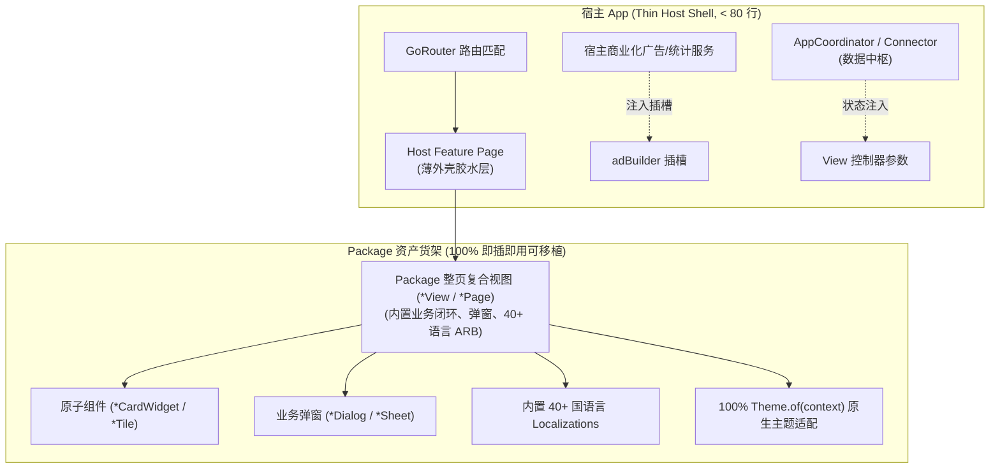

# 📦 货架优先 Package UI 全量封装与薄宿主外壳装配规范 (`shelf-first-package-ui-assembly-protocol`)

## 一、 架构背景与惨痛教训剖析

在 Flutter 模块化与多包生态中，最常见且隐蔽的架构退化现象是：**“名义上拆了 Package，实际上宿主 App 仍然手搓了数千行重复而臃肿的 UI”**。

### 1. 真实正反案例对比（现场证据）

- **✅ 正面典范：`lib/features/cloud_drive/pages/cloud_settings_page.dart`（仅 13 行）**
  ```dart
  import 'package:material_ui/material_ui.dart';
  import 'package:flutter_riverpod/flutter_riverpod.dart';
  import 'package:pyro_cloud_drive_ui/pyro_cloud_drive_ui.dart' as cloud_ui;

  /// 云盘设置页面 —— 100% 渲染包内 pyro_cloud_drive_ui 自注册标准页面
  class CloudSettingsPage extends ConsumerWidget {
    const CloudSettingsPage({super.key});

    @override
    Widget build(BuildContext context, WidgetRef ref) {
      return const cloud_ui.CloudSettingsPage();
    }
  }
  ```
  **优势**：整个云盘设置逻辑、各网盘绑定状态、40+ 语言本地化、加密密码弹窗全部闭环在 `pyro_cloud_drive_ui` 中，新 App 接入只需 13 行！

- **❌ 负面典型 1：`lib/features/cloud_drive/pages/backup_restore_page.dart`（高达 777 行）**
  宿主 App 在页面里自己维护 `_versions`、`_cloudBackupFiles`、手工调用文件选择器、手搓备份导入导出弹窗、手工拼接进度条。完全没有利用 Package 的封装优势，导致代码极度脆弱，无法移植。

- **❌ 负面典型 2：`lib/features/commercial/pages/purchase_page.dart`（278 行）**
  宿主 App 页面硬编码价格字典：
  ```dart
  final Map<String, String> _productPrices = {
    'remove_ads': '$3.99',
    'vip_monthly': '$2.99 / Month',
    ...
  };
  ```
  而在资产货架 `packages/commercial/pyro_purchase_ui` 中，明明已经具备完整的 `CommercialPrivilegeSheet`、`CommercialCardWidget` 以及全套响应式购买与 40+ 语言 ARB 体系，主 App 却重复造轮子。

---

## 二、 三大核心硬性铁律 (Core Axioms)

### 铁律一：货架优先原则 (Shelf-First Axiom)
1. **先查货架，严禁就地起炉灶**：
   在宿主 App 计划实现任何业务功能或界面前，**必须先检索 `packages/` 资产货架**（例如 `commercial`、`clouddrive`、`sync`、`user_database` 等）。
2. **已有 UI 必须 100% 强制装配**：
   如果子包中已存在对应的 `_ui`（如 `pyro_cloud_drive_ui`、`pyro_purchase_ui`、`pyro_sync_ui`），宿主 App **严禁重新编写同质化 UI**。
3. **能力不足回流 Package，严禁污染 Host**：
   若现有 Package UI 缺少某种布局样式或整页视图，**必须首先在对应的 `packages/*_ui` 中扩充导出**，补充好 ARB 与主题适配后，再由宿主 App 引入，绝不在 `lib/features/` 搞临时硬编码。

---

### 铁律二：宿主 App 极简薄外壳原则 (Thin Host Shell Law, < 50~80 Lines)
宿主 App 的 `lib/features/*/pages/*_page.dart` 只能是**极薄的装配胶水与路由外壳**，单文件行数硬性约束在 **50~80 行以内**。

宿主 Page 的**唯一合法职责**仅有以下四项：
1. **路由与参数提取**：通过 `GoRouter` 接收 URL Path 或 Query 参数；
2. **Scaffold 框架装配**：包裹全局 App 外壳、确定 AppBar 标题或返回键行为；
3. **控制器/中枢挂载**：通过 Riverpod `ref.watch` 或 Connector 获取状态，作为回调/配置注入给包内 View；
4. **插槽注入 (Slot Injection)**：向包内 View 注入宿主 App 专有的非侵入插槽，例如 `adBuilder: () => const InlineBannerAd()`。



---

### 铁律三：Package UI 自身全量自闭环原则 (Self-Contained Package UI)
一个真正可移植的 `*_ui` 包必须具备“整装上架”的完备度：
1. **三级视图供给矩阵**：
   - **原子级 (Atom Widgets)**：如 `PyroCommercialCardWidget`、`CloudSyncStatusWidget`；
   - **交互弹窗级 (Sheets & Dialogs)**：如 `CommercialPrivilegeSheet`、`EncryptionPasswordDialog`；
   - **整页复合级 (Composite Views)**：如 `PyroCloudSettingsView`、`PyroSyncSettingsView`、`PyroBackupRestoreView`。
2. **40+ 语言独立自备**：
   包内 `lib/l10n/` 必须自带完整的 40+ 语言 `.arb` 文件并生成独立 Localizations，保证挪到任何其它 Flutter 项目都能原生多语言运行，不依赖宿主字典。
3. **100% 原生系统主题自适应**：
   严禁使用硬编码色彩 (`Colors.black`, `Colors.white` 等)，所有背景、文字、边框一律使用 `Theme.of(context).colorScheme`。

---

## 三、 标准代码契约与装配范式

### 1. Package 侧：输出带插槽的高高度封装复合视图 (`*View`)

```dart
// 位于 packages/commercial/pyro_purchase_ui/lib/src/screens/commercial_center_view.dart
import 'package:material_ui/material_ui.dart';
import 'package:pyro_purchase_protocol/pyro_purchase_protocol.dart';
import '../widgets/commercial_card_widget.dart';

class PyroCommercialCenterView extends StatelessWidget {
  final CommercialUIConfig config;
  final List<ProductItem> products;
  final EntitlementState entitlementState;
  final ValueChanged<String> onPurchase;
  final VoidCallback onRestore;
  final WidgetBuilder? adBuilder; // 允许宿主注入横幅或激励广告位

  const PyroCommercialCenterView({
    super.key,
    required this.config,
    required this.products,
    required this.entitlementState,
    required this.onPurchase,
    required this.onRestore,
    this.adBuilder,
  });

  @override
  Widget build(BuildContext context) {
    final theme = Theme.of(context);
    final colorScheme = theme.colorScheme;

    return ListView(
      padding: const EdgeInsets.symmetric(horizontal: 16, vertical: 12),
      children: [
        // 头部权益展示
        _buildPrivilegeBanner(context, colorScheme),
        const SizedBox(height: 16),

        // 订阅商品列表 (纯原生自适应主题卡片)
        ...products.map((product) => CommercialCardWidget(
          product: product,
          isSelected: entitlementState.isVip,
          onTap: () => onPurchase(product.id),
        )),

        // 宿主广告插槽 (若宿主提供了 adBuilder，则优雅渲染)
        if (adBuilder != null) ...[
          const SizedBox(height: 16),
          adBuilder!(context),
        ],
      ],
    );
  }
}
```

---

### 2. 宿主 App 侧：极简薄套壳装配 (< 40 行典范)

```dart
// 位于 lib/features/commercial/pages/purchase_page.dart
import 'package:material_ui/material_ui.dart';
import 'package:flutter_riverpod/flutter_riverpod.dart';
import 'package:pyro_purchase_ui/pyro_purchase_ui.dart';
import 'package:yourcallyourrule/features/commercial/services/commercial_service.dart';
import 'package:yourcallyourrule/features/commercial/widgets/app_banner_ad.dart';

class PurchasePage extends ConsumerWidget {
  const PurchasePage({super.key});

  @override
  Widget build(BuildContext context, WidgetRef ref) {
    final commercialState = ref.watch(commercialServiceProvider);
    final commercialService = ref.read(commercialServiceProvider.notifier);

    return Scaffold(
      appBar: AppBar(
        title: Text(AppLocalizations.of(context)!.vipCenterTitle),
      ),
      body: PyroCommercialCenterView(
        config: commercialState.uiConfig,
        products: commercialState.availableProducts,
        entitlementState: commercialState.entitlements,
        onPurchase: (productId) => commercialService.buy(productId),
        onRestore: () => commercialService.restore(),
        adBuilder: (context) => const AppBannerAd(), // 一行挂载宿主广告
      ),
    );
  }
}
```

---

## 四、 跨 App 移植与复用实施规范

当未来需要开发新 App（如 App B、App C）时，复用流程必须遵循以下标准化动作：

1. **零代码修改引入**：
   在 `pubspec.yaml` 中声明依赖：
   ```yaml
   dependencies:
     pyro_cloud_drive_ui:
       path: ../packages/clouddrive/pyro_cloud_drive_ui
     pyro_purchase_ui:
       path: ../packages/commercial/pyro_purchase_ui
   ```
2. **多语言与路由无缝对接**：
   在主 App 的 `localizationsDelegates` 中加入包内生成的 Delegate：
   ```dart
   localizationsDelegates: [
     ...AppLocalizations.localizationsDelegates,
     ...pyro_cloud_drive_ui.AppLocalizations.localizationsDelegates,
     ...pyro_purchase_ui.AppLocalizations.localizationsDelegates,
   ]
   ```
3. **路由页面 10 秒快速装配**：
   直接创建 Thin Host Shell 挂载对应的 View，无需重写任何布局、样式、多语言与网络通信！

---

## 五、 自动化审查与防退化门禁 (Anti-Regression Checklist)

任何 PR 或提交前，必须运行以下自审红线：

| 检查项 | 判定准则 | 处置手段 |
| :--- | :--- | :--- |
| **页面行数红线** | `lib/features/*/pages/*.dart` 单文件超过 80 行 | 立即拦截，将 UI 与逻辑下沉至 `packages/*_ui` |
| **重复造轮子** | 宿主 App 中出现商品价格硬编码、手写网盘连接列表 | 立即剔除，替换为货架 Package 现成 View/Sheet |
| **色彩硬编码** | 出现 `Colors.white`、`Colors.black` 或三元判断 | 强制重构为 `Theme.of(context).colorScheme.*` |
| **语言缺失** | 出现英文字符串字面量未走 `l10n` | 补齐 Package 内 40+ 语言 ARB 词条 |
| **插槽孤立** | 宿主硬改 Package 源码插入广告 | 改为在 Package View 中暴露 `adBuilder` 插槽并由宿主传入 |
