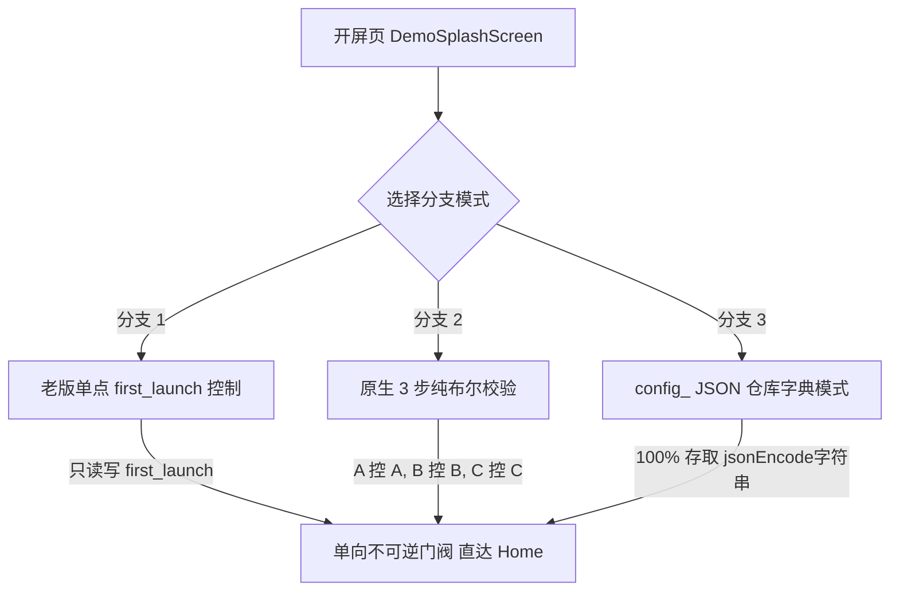

# Demo Splash 踩坑总结与核心经验教训 (Lessons Learned)

> **项目名称**：`demo_splash_app`  
> **核心目的**：彻底复盘冷启动无限跳转 Onboarding 的根本原因，提炼 Android 原生存储机制、Flutter 状态治理与路由导向的踩坑经验，指导主 App 后续安全修改。

---

## 📌 一、 核心现象与故障复现 (Symptoms)

在主 App 开发中，曾经出现过**“走完了 Onboarding / Initial Setup 流程进入主页后，划掉 App 强杀进程重新打开，App 依然重复弹入 Onboarding 引导页”**的无限死循环现象。

---

## 🔍 二、 四大核心根因深度剖析 (Root Cause Analysis)

### 1. Android 原生 `apply()` 异步刷盘与“划掉杀进程”的时序碰撞
* **现象**：代码里明明写了 `prefs.setBool('first_launch', false)`，但重启后读取依然是 `null`。
* **原理**：Flutter `shared_preferences` 插件在 Android 原生层调用的是 `SharedPreferences.Editor.apply()`。`apply()` 是**非阻塞的异步后台写盘**。
* **致命时序**：用户在页面操作完成后，或者在路由跳转（`goNamed`）一瞬间组件被卸载（`dispose`），如果用户在此刻划掉杀掉 App 进程，Android `SIGKILL` 信号会直接抹去内存。后台异步写盘任务还没来得及落盘到手机存储的 XML 文件中，导致**磁盘数据丢失**。
* **兜底误判**：开屏页冷重启时读取磁盘文件拿到 `null`，执行 `prefs.getBool('first_launch') ?? true`，因 `null` 触发了 `?? true` 的降级假设，再次误判为“首次启动”。

### 2. 跨模块变量越权与并发修改 (Violation of SRP)
* **现象**：`SplashScreen` 改动 `first_launch`，`OnboardingService` 也去强改 `first_launch`，`InitialSetupService` 也去强改 `first_launch`。
* **原理**：违反了**单一职责原则（A 控 A，B 控 B，C 控 C）**。一个变量如果在 3 个不同的文件、不同的生命周期时机被反复篡改，必然引发变量竞态冲突与状态混乱。

### 3. `config_` 前缀与原生 `ClassCastException` 崩溃
* **现象**：App 启动时抛出 `java.lang.ClassCastException: java.lang.Boolean cannot be cast to java.lang.String`。
* **原理**：项目中的 `ConfigCloudConverter` 会自动扫描 SharedPreferences 中所有以 `config_` 开头的键，并强制调用 `getString()` 准备进行云端备份。如果某个以 `config_` 开头的键被存为了原生 `bool`，Android 原生 `SharedPreferencesImpl.java` 会在类型校验时强行抛出崩溃！
* **解决原则**：
  * **法则 A**：只要带有 `config_` 前缀，值**必须 100% 存为 JSON 字典字符串**（如 `{"value": true}`，对齐 `PurchaseState`）；
  * **法则 B**：如果不通过 `ConfigRepository` 备份，则**绝不加 `config_` 前缀**，使用纯原生 Key（如 `first_launch`）。

### 4. 自动化测试 (Memory) 与真机强杀 (Disk) 的物理隔阂
* **现象**：`flutter test` 脚本日志显示全通过，但在真机划掉重启依然失败。
* **原理**：常规 `flutter test` / `WidgetTester` 运行在同一个 Dart VM 内存进程中，`pumpWidget` 重绘 UI 并没有物理销毁 SharedPreferences 单例与内存缓存。只有真实手机杀进程，才会暴露“异步 `apply()` 未落盘”的死穴。

---

## 🛠️ 三、 校验通过的三种标准解法 (Verified Solutions)

在本 Demo App (`demo_splash_app`) 中，我们完美验证并保留了三种标准解决方案：

### 1. 分支 1：老版单点控制模式（单向不可逆门阀）
* **逻辑**：`SplashScreen` 独占 `first_launch` 变量。
* **执行**：首次启动时在跳转前**必须 `await` 异步写盘完毕**，将 `first_launch` 写为 `false`。
* **优势**：极简不可逆，后续重启直接判定 `first_launch == false` 送入 Home，零倒流风险。

### 2. 分支 2：原生 3 步纯布尔校验模式（权责隔离）
* **逻辑**：严格遵循 **A 控 A，B 控 B，C 控 C**。
* **Key**：`first_launch`（Splash 控）、`has_completed_onboarding`（Onboarding 控）、`has_completed_initial_setup`（Initial Setup 控）。
* **优势**：无 `config_` 前缀，零云同步强转风险，各模块各自管各自。

### 3. 分支 3：`config_` JSON 字典仓库模式（对齐 `PurchaseState`）
* **逻辑**：与 `ConfigRepository` 和 `PurchaseState` 100% 深度兼容。
* **Key**：`config_has_completed_onboarding`、`config_has_completed_initial_setup`。
* **存储格式**：`jsonEncode({'value': true})`。
* **优势**：支持云端备份与恢复，且 `getString()` 解包 JSON 不会抛出 `ClassCastException`。

---

## 🚀 四、 今后主 APP 重构修改指导原则 (Actionable Rules)

1. **绝对禁止跨模块篡改变量**：`SplashScreen` 只管 `first_launch`，`Onboarding` 只管自己的完成标志，`InitialSetup` 只管自己的完成标志。
2. **写盘必须明确等待或一进入就锁定**：用户触达页面（`initState`）即刻锁定，或在路由跳转前明确 `await` 写盘完成，绝不在组件卸载后隐式悬空写盘。
3. **严格遵守 Key 命名规范**：需要云同步的走 `config_` + JSON 字符串，不需要云同步的走原生 Key + 原生 Bool，两者界限分明。
