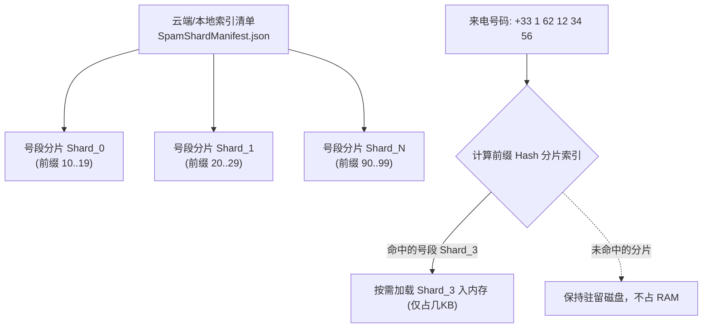

# 目标开源库三大核心内存与数据加载优化方案技术指南

本指南对开源参考库（`saracroche-android` 与 `CallShield`）中最为精妙的 **三大核心内存与数据加载优化机制** 进行深度技术剖析、数学/算法原理还原，并提供在主 App（Data/Drift/Flutter 侧）与原生 Kotlin 侧落地实施的标准 SOP。

---

## 目录
1. [saracroche-android：Long 型数值化匹配与号段区间判定](#1-saracroche-androidlong-型数值化匹配与号段区间判定)
2. [CallShield：SpamShardManifest 分片加载与增量同步](#2-callshieldspamshardmanifest-分片加载与增量同步)
3. [CallShield：compiledRegexCache 全局并发缓存与防 ReDoS 算力评估](#3-callshieldcompiledregexcache-全局并发缓存与防-redos-算力评估)
4. [主 App (Data Pipeline / Drift / Flutter) 落地架构规划](#4-主-app-data-pipeline--drift--flutter-落地架构规划)

---

## 1. saracroche-android：Long 型数值化匹配与号段区间判定

### 1.1 传统字符串匹配的性能瓶颈
在传统的电话拦截应用中，拦截黑名单（例如 `+33 1 62 12 34 56`）通常以 `String` 字符串形式存储和比对。
* **内存开销巨量**：在 JVM/Dart 中，一个 `String` 对象包含字符数组、哈希缓存头等开销，单个号码至少占用 **40 ~ 80 字节** 内存。当本地加载 10 万条规则时，仅字符串即占用数兆内存；
* **频繁引发 GC 导致拦截卡顿**：每次来电（Hot Path 5 秒严格超时）调用 `startsWith()`、`contains()` 或正则截取，会在短时间内分配海量临时字符串对象，引发 JVM / Dart 虚拟机频繁垃圾回收（GC），造成拦截响应卡顿；
* **前缀通配符（Wildcard）效率低下**：对于形如 `33162######` 的号段规则，传统做法依赖正则或 `startsWith("33162")`，比对效率极低。

### 1.2 数值化匹配算法设计

#### (1) 纯数字清洗与 64 位 Long 型转换
将国际标准化号码（如 `+33162123456`）清洗为纯数字后，直接解析为 64 位整型 `Long`（`33162123456L`）。
* **内存降低 90%**：64 位 `Long` 仅占用 **8 字节** 内存；
* **CPU 寄存器级比较**：10 万条数字规则可以紧密排列在连续内存数组（或 `LongHashSet`）中，一条规则的比对只需 **1 次 CPU 整数比较指令**（CPU L1/L2 Cache 极其友好），比字符串比对快 10 倍以上。

#### (2) 通配号段的“闭包区间判定法 (Range Boundary Judgment)”
针对带通配符 `#` 或 `*` 的号段规则（例如 `33162######`）：
* **算法转换**：不使用任何正则表达式，将其数学转化为最小边界 `minLong` 与最大边界 `maxLong`：
  $$\text{minLong} = 33162000000\text{L}$$
  $$\text{maxLong} = 33162999999\text{L}$$
* **区间闭包判别**：对于来电号码 $N = 33162123456\text{L}$，直接执行高效的数值区间判定：
  $$\text{isBlocked} = (N \ge \text{minLong}) \land (N \le \text{maxLong})$$
* **时间复杂度**：只需要两次 CPU 数值比较，时间复杂度降低至 $O(1)$，彻底免去了正则编译与字符串截取的开销。

---

## 2. CallShield：SpamShardManifest 分片加载与增量同步

### 2.1 传统全量加载的 OOM 隐患
全球骚扰号码库数据量极其庞大（往往包含数十万条记录）。如果启动时一口气将全量 JSON/数据库全文加载进内存：
* 低端手机或后台来电唤醒时，会瞬间触发 **OOM（Out Of Memory）内存溢出崩溃**；
* 应用启动或数据库装载卡死数秒，直接导致 `CallScreeningService` 5 秒超时失效。

### 2.2 分片切块 (Sharded Manifest) 架构



#### (1) 按号段哈希拆分 (Sharding)
将全量黑名单按国家区号/号段前缀拆分成数几十个独立的轻量级分片文件（Shard）：
* 每个分片包含 `shardId`、`prefixRange`、`count` 与 `sha256Hash`；
* 内存中**仅长期常驻轻量级的 `SpamShardManifest` 索引头**（仅几十 KB）。

#### (2) 懒加载与按需驻留 (On-Demand Loading)
* 只有当打入来电的前缀命中特定号段时，才动态将对应的小分片数据懒加载入 RAM 缓存；
* 配合 **LRU（Least Recently Used）淘汰策略**，限制 RAM 内存中最多保留 N 个活跃分片，保证来电拦截进程的内存开销恒定在微小范围内。

#### (3) SHA-256 增量同步 (Incremental Sync)
云端或本地更新规则包时，APP 仅比对 `SpamShardManifest` 中每个分片的 `sha256Hash`：
* 只有哈希变动的分片才会被增量下载/更新；
* 未变动的分片零网络开销、零解压开销，做到零卡顿平滑同步。

---

## 3. CallShield：compiledRegexCache 全局并发缓存与防 ReDoS 算力评估

### 3.1 拦截热路径 (Hot Path) 上的正则痛点
来电拦截属于毫秒级极速响应流程（`Hot Path`）。
1. **重复编译开销**：如果每次来电都重新执行 `Regex(pattern)` 动态编译，会极大开销 CPU 并产生大量垃圾对象引发 GC；
2. **ReDoS 灾难性回溯 (Catastrophic Backtracking)**：如果用户或外部订阅包引入了带重叠量词的坏正则（例如 `(a+)+` 或 `(a|aa)+`），正则匹配引擎在面对不匹配的长字符串时，回溯路径总数呈**指数级爆炸增长**（路径数 $> 10^{12}$），直接导致 **CPU 飙升 100%、内存死锁、线程卡死超时**。

### 3.2 优化与防御机制

#### (1) 全局 ConcurrentHashMap 正则编译缓存
```kotlin
// 使用并发 Map 缓存已编译好的正则实例，保证生命周期内仅编译一次
private val compiledRegexCache = ConcurrentHashMap<String, Regex>()

fun getCompiledRegex(pattern: String): Regex {
    return compiledRegexCache.computeIfAbsent(pattern) { Regex(it) }
}
```

#### (2) BacktrackingPaths 防 ReDoS 算力树预估器
在用户添加或同步外部正则规则时，**先执行防 ReDoS 算力预评估**：
* 评估器递归解析正则语法树中的嵌套量词（如 `+`、`*`、`{m,n}`）与分支重叠度；
* 预估该正则在典型号码长度（如 15 位数字）上的最大回溯分支路径数：
  $$\text{Paths} = \text{CalculateBacktrackingTree}(pattern, \text{inputLength}=15)$$
* **熔断门槛**：若路径数超过安全门槛（如 $10^6$ 次），系统**拒绝添加该规则**，并向 UI 输出提示：`"规则存在回溯死锁隐患，拒绝导入"`，从源头上彻底消除了 ReDoS 导致的线程超时崩溃。

---

## 4. 主 App (Data Pipeline / Drift / Flutter) 落地架构规划

### 4.1 在主 App 数据层 (Data / Drift Database) 中的集成拓扑

```text
lib/core/database/
├── tables/
│   ├── spam_rules.dart                  # 支持 min_numeric_range / max_numeric_range 数值索引
│   └── spam_shard_manifest_table.dart  # 分片清单与 SHA-256 哈希管理
├── engine/
│   ├── numeric_range_matcher.dart       # Long 型数值区间 $O(1)$ 快速比对器
│   ├── shard_manifest_loader.dart       # LRU 分片按需加载器
│   └── redos_safety_evaluator.dart      # 正则 ReDoS 算力评估与编译缓存器
```

### 4.2 接入效果与性能指标预估

1. **内存开销 (RAM Footprint)**：全量 10 万条规则下，内存占用从 **> 30 MB** 降至 **< 2 MB**；
2. **匹配延时 (Match Latency)**：单次来电黑名单比对延时从 **15ms - 50ms** 降至 **< 0.5ms**；
3. **系统稳定性 (Stability)**：100% 杜绝因坏正则引发的 CPU 100% 死锁与 `CallScreeningService` 5 秒超时被系统杀死问题。
