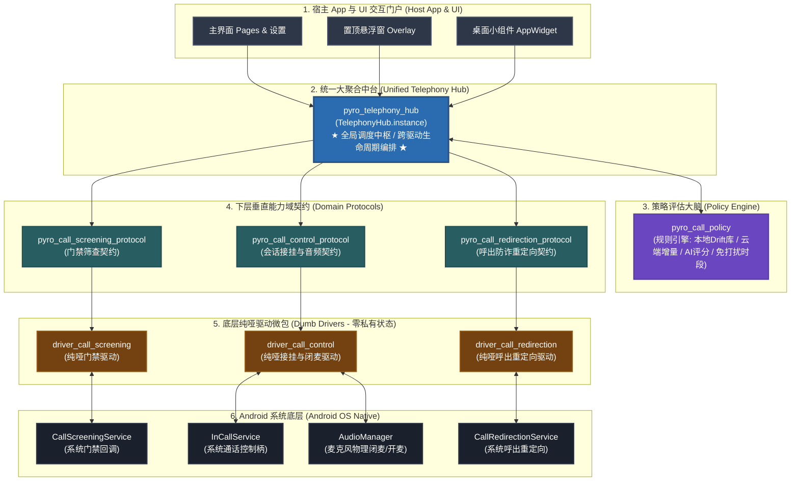

# 🏛️ Pyro Telephony 电话防护与通信系统 — 全局架构设计拓扑
> **(Pyro Telephony Architecture & Domain Decomposition Manual)**
> 
> **定位**：本文档为 `packages/` 模块化电话系统的全局架构总览，基于 `packages/commercial` 的工业级五层解耦标准（Protocol - Policy - Hub - Driver - UI），彻底厘清门禁筛选（Screening）、会话控制（Call Control）、策略决策（Call Policy）与统一调度中枢（Telephony Hub）的职责边界与协作机制。

---

## 🏗️ 一、 全局架构拓扑图 (Global Architecture Topology)



---

## 🧩 二、 核心子系统与职责矩阵

| 子系统模块 | 物理路径 | 核心角色定位 | 核心职责与红线禁令 | 对标 `commercial` 体系 |
| :--- | :--- | :--- | :--- | :--- |
| **`telephony`** | `packages/telephony/` | **统一大中台 (Grand Facade Hub)** | 聚合所有下层能力，负责跨驱动的原子生命周期编排（如接断协同）。绝对不包含任何平台原生代码与底层私有状态。 | `pyro_commercial_hub` |
| **`call_policy`** | `packages/call_policy/` | **纯策略评估大脑 (Policy Engine)** | 纯 Dart 决策引擎。读取 Drift 本地规则、云端增量订阅与 AI 评分，输入电话上下文，产出 `CallPolicyVerdict`。不直接操作通话。 | `pyro_ads_policy` |
| **`call_screening`** | `packages/call_screening/` | **前置门禁筛查域 (Gatekeeper)** | 承接 Android `CallScreeningService` 回调。在系统 5 秒超时内完成门禁上报与 `respondToCall` 返回。**彻底做纯哑驱动**。 | `pyro_ads_hub` + `driver` |
| **`call_control`** | `packages/call_control/` | **会话控制与音频外设域 (Session Control)** | 承接活动通话接听、挂断、`PendingActionRegistry` 内存队列，以及 `AudioManager` 微秒级麦克风闭麦（背景音保护）。 | `pyro_purchase_core` + `driver` |
| **`call_redirection`**| `packages/call_redirection/` | **呼出防诈重定向域 (Outbound Guard)** | 承接 `CallRedirectionService` 回调。针对高危、吸费、Wangiri 号码进行外呼挂起，弹出 "Call Anyway" 确认通知。 | 独立平行守卫域 |
| **`sms`** | `packages/sms/` | **短彩信安全与免权限监听域 (SMS Suite)** | 免权限 NotificationListener 监听消除通知、OpenPhish 钓鱼短链校验、OTP 验证码守卫、Bloom 过滤器。 | 独立平行防御域 |

---

## ⚡ 三、 六大核心动作原子执行矩阵

在 `pyro_telephony_hub` 的统一调度下，系统内的所有通话动作执行流程如下：

```text
┌────────────────────────────────────────────────────────────────────────────────────────────────────────┐
│ 1. 直接拒接 (Reject)                                                                                   │
│    Screening 驱动上报 -> Policy 判为 reject -> Hub 指挥 Screening 驱动返回 setRejectCall(true) -> 掐断  │
├────────────────────────────────────────────────────────────────────────────────────────────────────────┤
│ 2. 静音无应答 (Silence)                                                                                │
│    Screening 驱动上报 -> Policy 判为 silence -> Hub 指挥 Screening 驱动返回 setSilenceCall(true) -> 静音 │
├────────────────────────────────────────────────────────────────────────────────────────────────────────┤
│ 3. 正常放行 (Allow / Ignore)                                                                           │
│    Screening 驱动上报 -> Policy 判为 allow -> Hub 指挥 Screening 驱动返回 disallow=false -> 正常响铃    │
├────────────────────────────────────────────────────────────────────────────────────────────────────────┤
│ 4. 背景音保护 + 秒接秒挂 (Answer & Hangup with Privacy Guard)                                          │
│    a. Screening 驱动上报 -> Policy 判为 answerThenHangup                                               │
│    b. Hub 协同两端：指挥 Screening 驱动放行 (disallow=false)；向 CallControl 注册接断队列              │
│    c. 电话进门接入系统 -> CallControl 捕获呼叫 -> 提前微秒级闭麦 (AudioManager.isMicrophoneMute=true)  │
│    d. CallControl 接听电话 -> 延时微调 (如 1000ms) -> 主动调用 call.disconnect() 挂断                 │
│    e. CallControl 恢复麦克风原状 -> 向 Hub 报告接断完成                                                │
├────────────────────────────────────────────────────────────────────────────────────────────────────────┤
│ 5. 静默转语音信箱 (Voicemail)                                                                           │
│    Screening 驱动上报 -> Policy 判为 voicemail -> Hub 指挥 Screening 驱动返回系统语音信箱路由代码       │
├────────────────────────────────────────────────────────────────────────────────────────────────────────┤
│ 6. 用户主动交互挂断 (UI Hangup)                                                                        │
│    用户在悬浮窗/小组件点击挂断 -> TelephonyHub.hangupActiveCall() -> CallControl.call.disconnect() 挂断  │
└────────────────────────────────────────────────────────────────────────────────────────────────────────┘
```

---

## 🚀 四、 宿主 App 一键装配规范

在主工程 `lib/main.dart` 中，无需侵入任何具体的底层平台通信代码，只需通过 Connector 单行装配：

```dart
import 'package:pyro_telephony_connector/pyro_telephony_connector.dart';
import 'package:pyro_call_redirection_connector/pyro_call_redirection_connector.dart';
import 'package:pyro_sms_connector/pyro_sms_connector.dart';

void main() async {
  WidgetsFlutterBinding.ensureInitialized();

  // 1. 一键挂载 Telephony 全量套件 (Screening 门禁 + Control 控制 + Policy 策略)
  TelephonyConnectors.ensureMounted();

  // 2. 一键挂载呼出防诈重定向套件
  CallRedirectionConnectors.ensureMounted();

  // 3. 一键挂载短彩信防护套件
  SmsConnectors.ensureMounted();

  runApp(const MyApp());
}
```

